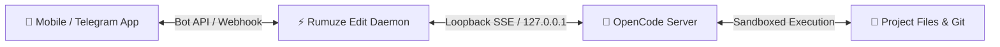

# ⚡ Rumuze Edit

> **Remote AI Coding Agent Bridge & Live Telegram Control Room**  
> Control [OpenCode](https://opencode.ai), AI coding agents, and terminal tools on your local machine or VPS directly from your phone via Telegram.

[](https://www.npmjs.com/package/rumuze-edit)
[](https://www.npmjs.com/package/rumuze-edit)
[-success.svg?style=flat-square)](https://www.npmjs.com/package/rumuze-edit)
[](https://github.com/rumuze/rumuze-edit/actions)
[](https://packagist.org/packages/rumuze/edit)
[](https://github.com/rumuze/rumuze-edit/releases/latest)
[](LICENSE)
[](https://python.org)
[](https://nodejs.org)

<p align="center">
  <a href="https://www.npmjs.com/package/rumuze-edit"><b>📦 View on NPM</b></a> •
  <a href="https://packagist.org/packages/rumuze/edit"><b>🐘 View on Packagist</b></a> •
  <a href="https://github.com/rumuze/rumuze-edit/releases/latest"><b>🏷️ Release Notes (v1.0.3)</b></a> •
  <a href="#-quick-start"><b>🚀 Quick Start</b></a> •
  <a href="#-frequently-asked-questions-faq"><b>❓ FAQ</b></a>
</p>

---

## 🌟 Why Rumuze Edit?

Developers shouldn't be glued to their desks waiting for an AI agent to finish modifying files or running test suites. 

**Rumuze Edit** turns your Telegram into a high-powered developer mission control:
* 📲 **Live Streaming Card:** Watch the agent's progress update in real-time right in your Telegram chat (refreshes smoothly every ~2.5s).
* 🔘 **Interactive Buttons:** Approve/reject file edits, pick AI models, switch agents, and answer multi-choice agent questions with single clicks.
* 🔒 **Zero-Trust Security Sandbox:** Path isolation prevents escaping project directories; dangerous commands (`rm -rf /`, `sudo`, reading SSH keys) are blocked by default.
* ⚡ **Zero External Dependencies:** Built with pure Node.js and Python Standard Library (`stdlib`). No bloated `node_modules` and **zero `pip install`** needed!
* 🚀 **Universal Package:** Install via **NPM** (`npx rumuze-edit`) or **Composer / Laravel** (`composer require --dev rumuze/edit`).

---

## 🏗️ Architecture



### The Telegram Experience

```text
┌────────────────────────────────────────────────────────┐
│ ⚡ Rumuze Edit · Live Mission Control                   │
│                                                        │
│ Agent: 🧠 build | Model: 🤖 space-bunny-free           │
│ Status: 🟢 Executing bash (npm test)                   │
│ Step: 4/12 · ⏳ 14s · 📝 3 files modified              │
│                                                        │
│ ────────────────────────────────────────────────────── │
│ > PASS tests/auth.test.js                              │
│ > PASS tests/api.test.js                               │
│ > All 14 tests passing                                 │
│ ────────────────────────────────────────────────────── │
│                                                        │
│ [ ⏹ Stop ]      [ 📤 Diff ]      [ 📊 Status ]        │
│ [ 🧠 Agents ]   [ 🤖 Models ]    [ 🔒 Mode ]           │
└────────────────────────────────────────────────────────┘
```

---

## 🚀 Quick Start

### 1. Via NPM (Global Installation)

Install globally across your machine:

```bash
npm install -g rumuze-edit

# Initialize in any repo
rumuze-edit init

# Start control room
rumuze-edit start
```

### 2. Via NPX (Zero-Install Instant Runner)

Run immediately in any project without installing globally:

```bash
# Launch interactive pairing wizard
npx rumuze-edit init

# Run in foreground
npx rumuze-edit start

# Or run in background as a detached daemon
npx rumuze-edit start --daemon
```

---

### 2. Via Composer / Laravel (For PHP & Laravel teams)

Install as a development dependency:

```bash
composer require --dev rumuze/edit
```

Run directly via Composer:
```bash
./vendor/bin/rumuze-edit init
./vendor/bin/rumuze-edit start
```

Or inside any **Laravel** application via Artisan:
```bash
php artisan rumuze:edit init
php artisan rumuze:edit start --daemon
```

---

### 4. Via Docker Compose (Headless VPS & Servers)

Run 24/7 on any cloud server or VPS:

```bash
# Clone and enter directory
git clone https://github.com/rumuze/rumuze-edit.git && cd rumuze-edit

# Run with your credentials
TG_BOT_TOKEN="your_bot_token" TG_ALLOWED_CHAT_ID="your_chat_id" docker compose up -d
```

---

## 🎮 Telegram Controls & Features

Once connected, your Telegram bot becomes your project dashboard:

| Command / Action | Description |
|---|---|
| **Live Status Card** | Edits automatically every ~2.5s showing active tools, steps, and output tails |
| **Permission Buttons** | Any tool requiring approval (bash, write, edit) renders inline buttons: `[Once] [Reject]` |
| **Interactive Questions** | Agent questions appear as clickable buttons (single-choice, multi-select, or custom text) |
| `/agents` | Switch between active agents (e.g., `build`, `delegate`, `code-review`) |
| `/models` | Select provider and model on the fly |
| `/mode` | Toggle between `read` (read-only diagnosis) and `build` (active file modification) |
| `/diff` | Get a summary of all unstaged and staged code changes in the project |
| `/usage` | View token consumption, free tier limits, and countdown timers |
| `/stop` | Immediately interrupt and terminate the running agent process |
| `/sync` | Fast-forward git sync (`git pull --ff-only`) if the working tree is clean |

---

## 🛠️ CLI Reference

```text
rumuze-edit <command> [options]
npx rumuze-edit <command> [options]

COMMANDS:
  init               Interactive setup wizard & automatic Telegram pairing
  start              Start the control room for the current project
  stop               Stop running background daemon
  status             Display current daemon, server, and workspace status
  service install    Install as persistent background service (macOS launchd / Linux systemd)
  service uninstall  Remove persistent background service
  service status     Check persistent background service status
  help               Display help message

OPTIONS:
  --dir <path>       Set target project directory (defaults to current working directory)
  --daemon, -d       Run in background as a detached process
  --version, -v      Show version number
```

### Running as a Persistent System Service
Want Rumuze Edit to run automatically whenever your machine or server boots?

```bash
# On macOS (installs to ~/Library/LaunchAgents/com.rumuze.edit.plist)
# On Linux (installs to ~/.config/systemd/user/rumuze-edit.service)
npx rumuze-edit service install
```

---

## 🔒 Security Sandboxing

Rumuze Edit is engineered with a strict security model:
1. **Single Chat ID Lock:** Every message and inline callback query validates `chat.id == ALLOWED_CHAT_ID`. Unknown users are ignored.
2. **Loopback Server:** OpenCode server runs strictly on `127.0.0.1` with a per-session randomized high-entropy password.
3. **Execution Blocklist:** Denies destructive patterns by default:
   - `rm -rf /` or `rm -rf ~`
   - `sudo` elevation
   - Reading `id_rsa`, `id_ed25519`, `.pem`, `.ppk`
   - Leaking `.env` or production credentials
   - Path traversal (`../`) outside the configured workspace directory.
4. **Token Isolation:** Bot token is saved with `0600` file permissions in `~/.config/rumuze-edit/config.json`.

---

## ❓ Frequently Asked Questions (FAQ)

### Can I run this on a remote VPS?
**Yes!** Install Rumuze Edit on your VPS or cloud instance, run `npx rumuze-edit start --daemon`, and you can control server maintenance or fixes directly from Telegram without opening an SSH client.

### Does it require a paid Telegram Bot account?
**No.** It uses standard free Telegram bots created in seconds through [@BotFather](https://t.me/botfather).

### Can multiple developers share the same bot?
By design, each Rumuze Edit daemon is bound to a single user (`ALLOWED_CHAT_ID`) for ironclad security. If multiple team members want to use it, each developer can run their own daemon with their own bot token.

---

## 🤝 Community & Contributing

* Read our [Contributing Guide](CONTRIBUTING.md) to get started.
* Review our [Code of Conduct](CODE_OF_CONDUCT.md).
* Report security concerns following our [Security Policy](SECURITY.md).

---

## 📄 License

Distributed under the **MIT License**. See [LICENSE](LICENSE) for more details.

Developed with ❤️ by **[Rumuze](https://rumuze.com)**.
